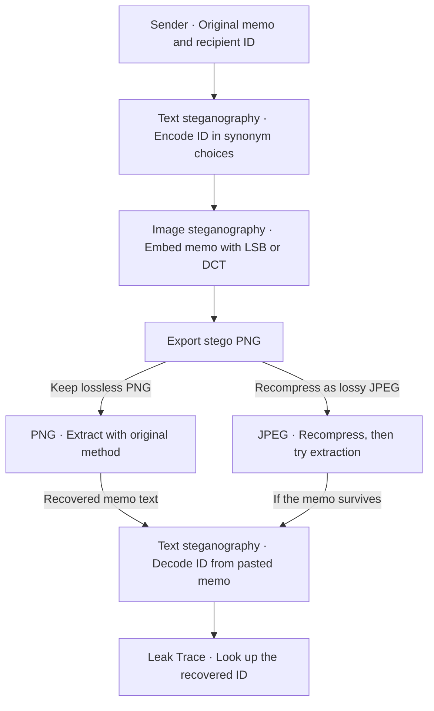
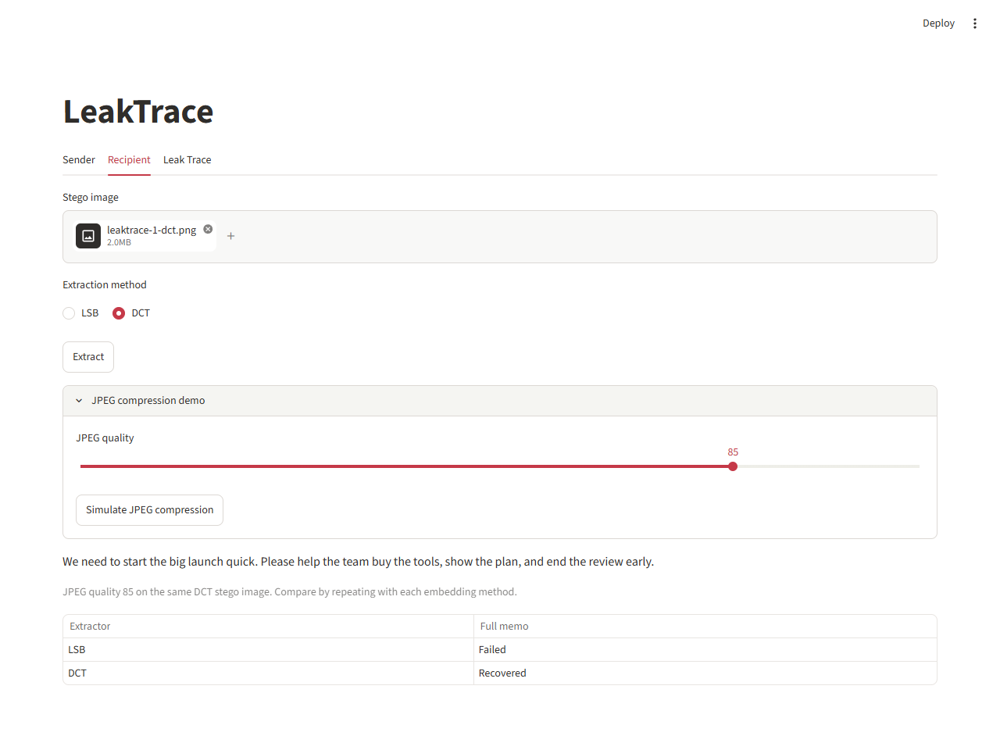
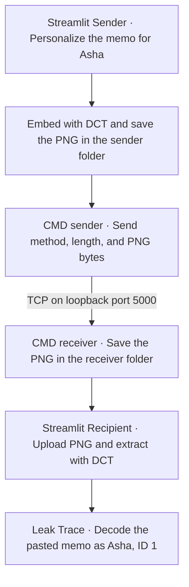

# LeakTrace

LeakTrace is a local Streamlit demo that fingerprints a memo for a recipient by changing synonym choices, embeds the personalized memo in an image, and traces a pasted copy from its wording.

## Run locally

Use Python 3.10 or newer. From the repository directory, run these commands in a virtual environment.

```sh
python -m pip install -r requirements.txt
python -m streamlit run app.py
```

Run `python test_all.py` to check all 255 fingerprint IDs, short and incomplete socket reads, and the PNG transfer and recovery for three recipients with both image methods.

## Architecture

LeakTrace uses **text steganography** to encode a recipient ID in the memo's wording, then **image steganography** to embed that memo in a cover image. Sender exports a PNG. The two paths below show what happens when the PNG is kept as-is or recompressed as JPEG.



### Follow one memo

1. **Sender** chooses Asha and a cover image. Asha's ID, `00000001`, changes `fast` to `quick` in the example memo. Sender embeds the personalized memo with LSB or DCT and exports a PNG.
2. **Recipient** takes one of two image paths.

   - **PNG path.** Keeping the exported PNG intact preserves the pixel values. The recipient uses the original embedding method, LSB or DCT, to recover the memo. The tab accepts an upload or uses the latest successful Sender output from the same session. The [TCP demo](#tcp-transfer-demo) transfers the exported PNG between two terminals before upload.
   - **JPEG path.** The compression demo recovers the original memo as a reference, re-encodes the image at the selected JPEG quality, and tries both extractors on the resulting image. It counts recovery only when the decoded memo matches the reference exactly. Recompression can alter both RGB channel bits and DCT coefficients. In the bundled trials, DCT recovered all three memos at qualities 95, 85, and 75, while LSB recovered none. See the [JPEG recompression results](#jpeg-recompression-results).
3. **Leak Trace** uses the same text decoder for both paths. If the JPEG path fails to recover the memo, that path ends at image extraction. With Asha's recovered memo from either path, the decoder reads `quick` for the last bit, reconstructs `00000001`, and looks up Asha in the registry.

### How the wording carries the ID

- **Write the bits.** The eight ordered synonym pairs represent the bits of an ID from 1 to 255, most significant first. Within each pair, the first word means `0` and the second means `1`. Sender requires a whole-word match for every pair and rewrites each match to the variant for the selected ID.
- **Read the bits.** Leak Trace counts occurrences of both words in each pair. The higher count decides the bit, so word order is irrelevant. A missing pair or a tie leaves an unknown bit.
- **Look up the ID.** When all eight bits are known, Leak Trace converts them to an integer and reports the matching name or an unregistered ID.

### How the image carries the memo

**Shared payload format**

```text
[4-byte big-endian byte count] [UTF-8 bytes of the personalized memo]
```

The encoder rejects empty memos and memos that exceed capacity. The decoder reads the byte count first, checks it against capacity, and then decodes that many bytes as UTF-8. An invalid count or invalid UTF-8 produces an extraction error.

| Method | Where each bit goes | Memo capacity on the bundled 1280 × 1280 cover |
| --- | --- | ---: |
| **LSB** (least significant bit) | The lowest bit of one RGB channel value | 614,396 bytes |
| **DCT** (discrete cosine transform) | One luminance coefficient in each of three consecutive 8 × 8 blocks | 1,062 bytes |

**LSB** walks the pixels in row order and overwrites the lowest bits of their RGB channel values. The decoder walks the same channels and reads those bits.

**DCT** uses complete 8 × 8 blocks in row order, skipping partial edge blocks.

1. Reserve RGB headroom for brightness changes and apply an orthonormal 2D DCT to each block's luminance.
2. Move the coefficient at zero-based row 4, column 3 to the nearest allowed multiple of 30. Even multiples carry `0` and odd multiples carry `1`. Apply the inverse transform and add the brightness change to all three RGB channels.
3. To decode a block, divide the coefficient by 30, round to an integer, and read whether it is even or odd. Take the majority across three consecutive blocks to recover each payload bit.

To calculate capacity, start with one bit per RGB channel for LSB, or one bit per group of three complete blocks for DCT. Subtract the 32-bit header, divide by eight, and round down to a whole number of bytes. The minimum capacity is zero.

### Where to find the code

| File | Responsibility |
| --- | --- |
| [`app.py`](app.py) | Runs the three tabs, converts images to RGB with Pillow, holds the recipient registry, and stores the latest PNG and method in session state. |
| [`stego_text.py`](stego_text.py) | Defines the synonym pairs and encodes or recovers the recipient ID. |
| [`stego_lsb.py`](stego_lsb.py) | Implements LSB and provides the shared payload packing and decoding helpers. |
| [`stego_dct.py`](stego_dct.py) | Implements DCT with NumPy and SciPy and uses the shared payload helpers. |
| [`tcp_transfer.py`](tcp_transfer.py) | Sends and receives exported PNGs and their embedding method over localhost TCP. |
| [`test_all.py`](test_all.py) | Checks text fingerprints, socket reads, and PNG round trips through both embedding methods. |

Both image modules expose `capacity_bytes(image)`, `embed(image, text)`, and `extract(image)`. The image is an 8-bit RGB NumPy array with shape `(height, width, 3)`. Embedding returns a new array so Sender can compare it with the original cover.

## Demo

1. In **Sender**, use the example memo, select Asha and DCT, and download the PNG. The preview shows the changed wording, capacity, PSNR, and amplified pixel differences.
2. In **Recipient**, upload the PNG or use the latest image from Sender. Select the same method, click **Extract**, and copy the recovered memo.
3. In **Leak Trace**, paste the memo and click **Trace leak**. The table shows the observed synonyms and bits. Try again with Ravi or Neha to see a different match.





## TCP transfer demo

Streamlit creates and extracts the hidden memo. The two TCP commands move the exported PNG between terminals on the same computer. The download and upload connect the two parts of the demo.



### Try it in Windows Command Prompt

1. In **CMD window 1**, go to the project folder and create separate folders for exported and received images. Replace `C:\path\to\LEAKTRACE` with your project path. The `/d` flag switches drives as well as directories.

   ```cmd
   cd /d "C:\path\to\LEAKTRACE"
   if not exist "samples\output\sender" mkdir "samples\output\sender"
   if not exist "samples\output\receiver" mkdir "samples\output\receiver"
   ```

2. Start Streamlit using the [local setup](#run-locally) and open [LeakTrace](http://127.0.0.1:8501). In **Sender**, choose Asha and **DCT**, then put the downloaded PNG at `samples\output\sender\leaktrace-1-dct.png`. Asha's ID is `00000001`, so the example memo uses `quick` for its last bit.
3. Start the receiver in **CMD window 1**.

   ```cmd
   python tcp_transfer.py receive "samples\output\receiver\received.png"
   ```

4. When window 1 prints `Listening on 127.0.0.1:5000`, send the image from **CMD window 2**.

   ```cmd
   cd /d "C:\path\to\LEAKTRACE"
   python tcp_transfer.py send "samples\output\sender\leaktrace-1-dct.png" dct
   ```

5. After window 1 prints `Saved`, upload `samples\output\receiver\received.png` in **Recipient**, select **DCT**, and click **Extract**. Paste the recovered memo into **Leak Trace** and click **Trace leak**. The expected result is `Asha (ID 1)`.

If you are using a project virtual environment named `.venv`, you can use `.venv\Scripts\python.exe` in place of `python` in both windows. To try LSB, export an LSB PNG, pass its filename and `lsb` to the sender, and select **LSB** in Recipient. Pick a fresh output filename if `received.png` already exists.

### What crosses the connection

Port **8501** serves the Streamlit page. Port **5000** handles the localhost TCP transfer. The TCP sender writes one method byte (0 for LSB, 1 for DCT), four bytes for the PNG length in big-endian order, and the original PNG bytes. The receiver reads until it has the declared byte count and saves one PNG per run, up to 10 MiB. This path preserves the PNG byte for byte. It uses unencrypted TCP on localhost.

## JPEG recompression results

The table counts exact memo recoveries out of three using the example memo personalized for Asha, Ravi, and Neha. Each method embedded the memos separately in the bundled 1280 × 1280 cover. Pillow saved each stego image as JPEG at the listed quality with its default subsampling.

| JPEG quality | LSB | DCT |
| --- | --- | --- |
| 95 | 0/3 | 3/3 |
| 85 | 0/3 | 3/3 |
| 75 | 0/3 | 3/3 |

The Recipient tab can repeat the experiment on one image at a time. Use the same cover and memo when comparing separately generated LSB and DCT images. Results depend on the cover and JPEG encoder. Use the downloaded PNG to preserve the embedded data.

## Limitations

- The prototype stores a single 8-bit ID in eight synonym pairs. Missing or tied pairs leave the ID incomplete. Paraphrasing or comparing multiple personalized copies can expose, remove, or change the fingerprint.
- A matching ID identifies wording associated with a distributed copy. The prototype cannot establish who shared it.
- The hidden memo is plaintext. The image payload has a length header and a UTF-8 check. Some image changes can produce altered text that still decodes.
- LSB is fragile under recompression and resizing. DCT has lower capacity and can also fail when an image is edited.

Sample cover by the NASA Apollo 17 crew, public domain in the United States. [The Blue Marble, AS17-148-22727](https://commons.wikimedia.org/wiki/File:The_Blue_Marble,_AS17-148-22727.jpg)
