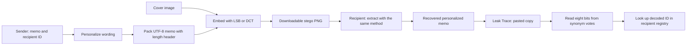
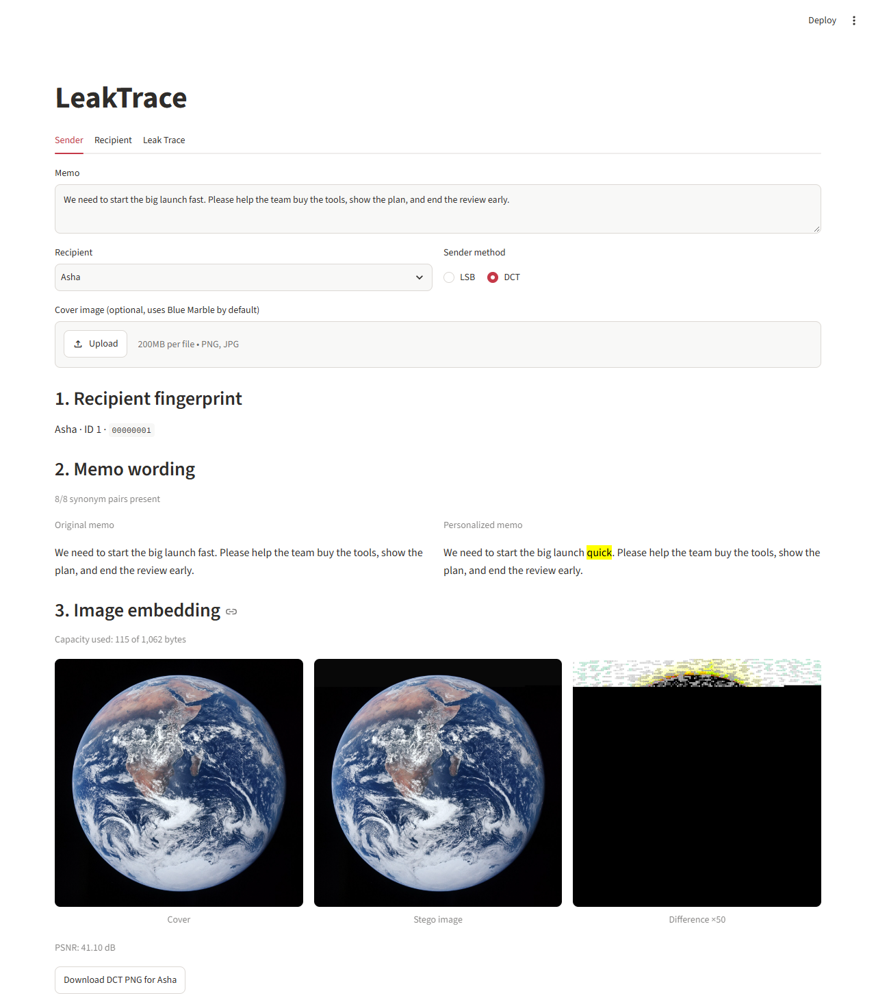
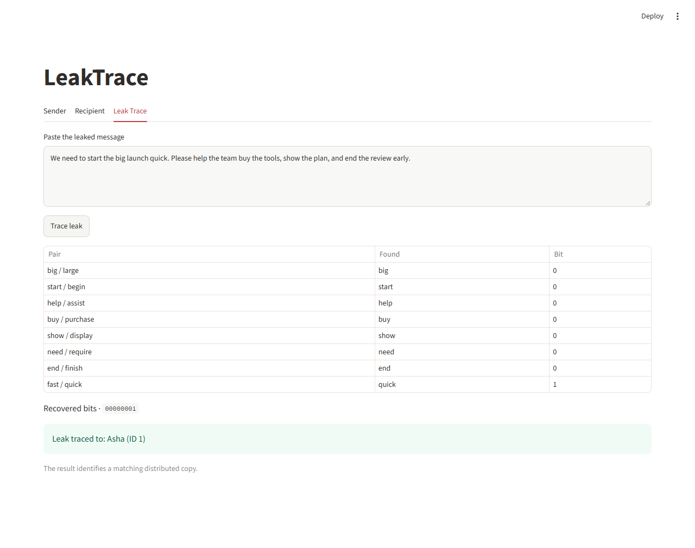

# LeakTrace

LeakTrace is a local Streamlit demo that fingerprints a memo for a recipient by changing synonym choices, embeds the personalized memo in an image, and traces a pasted copy from its wording.

## Run locally

Use Python 3.10 or newer. From the repository directory, run these commands in a virtual environment.

```sh
python -m pip install -r requirements.txt
python -m streamlit run app.py
```

Run `python test_all.py` to check all 255 fingerprint IDs and the PNG round trip for three recipients with both image methods.

## Architecture

LeakTrace runs as one Streamlit app with three tabs. The text layer encodes the recipient ID in the memo's wording. The image layer carries the personalized memo as a byte payload. After extraction, the recipient-specific wording can be traced from a pasted text copy alone.



### Components and interfaces

| Component | Responsibility |
| --- | --- |
| [`app.py`](app.py) | Coordinates Sender, Recipient, and Leak Trace. Converts uploads to RGB arrays with Pillow, picks the image method, prepares previews and downloads, and maps decoded IDs to names. |
| [`stego_text.py`](stego_text.py) | Defines the ordered synonym pairs. `embed_id(text, recipient_id)` creates personalized wording. `extract_id(text)` returns the decoded ID and the eight observed bits. |
| [`stego_lsb.py`](stego_lsb.py) | Implements spatial-domain embedding and provides the payload packing, header validation, and UTF-8 decoding helpers shared by both image methods. |
| [`stego_dct.py`](stego_dct.py) | Implements frequency-domain embedding and recovery using NumPy and SciPy. Imports the shared payload helpers from `stego_lsb.py`. |
| [`test_all.py`](test_all.py) | Checks text encoding, image round trips, and recovery of both the memo and recipient ID after PNG export and reload. |

Both image modules expose `capacity_bytes(image)`, `embed(image, text)`, and `extract(image)`. They use an 8-bit RGB array of shape `(height, width, 3)`. Embedding returns a new array, leaving the cover available for comparison. With valid inputs, Sender produces one PNG for the selected recipient. The app keeps the latest successful PNG bytes and the selected method in Streamlit session state for the Recipient tab. An uploaded image takes precedence over that session copy. The recipient registry is a dictionary in `app.py`.

### Text fingerprint

Each of the eight ordered synonym pairs represents one bit of an ID from 1 to 255. The first pair represents the most significant bit. Within each pair, the first word represents 0 and the second word represents 1. The Sender checks that the memo contains at least one whole-word match for every pair, then replaces each matching occurrence with the word for the corresponding bit. For example, Asha's ID is `00000001`, so the last pair, `fast / quick`, uses `quick`.

Leak Trace counts both variants of each pair in the pasted text and takes the majority vote. Reordering words leaves these votes unchanged. An absent pair or a tied count leaves that bit unknown and prevents a complete ID. If all eight bits resolve, the app converts them to an integer and reports the registered name or an unregistered ID.

### Image payload and recovery

Both image methods carry the same binary payload. The receiver selects the method used by the sender. The method stored in session state helps select it for an in-app handoff.

```text
[4-byte big-endian length in bytes][personalized memo encoded as UTF-8]
```

The image encoder rejects empty memos and payloads that exceed its capacity. During extraction, it reads the header first and validates the declared length against the image's capacity before reading the memo bytes and decoding UTF-8. Invalid lengths and invalid UTF-8 are reported as extraction errors. The length counts bytes, so some characters occupy more than one byte.

| Method | Embedding and recovery | Maximum memo bytes on the bundled 1280 × 1280 cover |
| --- | --- | ---: |
| **LSB** | Walks RGB channel values in row order, replacing the least significant bit of each value with one payload bit. Extraction reads the same bits from the same positions. Capacity is `max(0, (height * width * 3 - 32) // 8)`. | 614,396 |
| **DCT** | Walks complete 8 × 8 blocks in row order. Uses one luminance coefficient per block and repeats each bit across three consecutive blocks. Capacity is `max(0, (((height // 8) * (width // 8)) // 3 - 32) // 8)`. | 1,062 |

For DCT, the encoder reserves headroom in the selected RGB blocks before computing luminance. It uses an orthonormal 2D DCT and moves the coefficient at row 4, column 3 (zero-based) to the nearest multiple of 30 whose index is even for 0 or odd for 1. It applies the inverse transform and adds the resulting brightness change to all three RGB channels. The decoder recomputes that coefficient, rounds its value divided by 30 to read the index parity, and takes the majority across each group of three blocks. Partial blocks at the right and bottom edges are skipped.

## Demo

1. In **Sender**, use the example memo, select Asha and DCT, and download the PNG. The preview shows the changed wording, capacity, PSNR, and amplified pixel differences.
2. In **Recipient**, upload the PNG or use the latest image from Sender. Select the same method, click **Extract**, and copy the recovered memo.
3. In **Leak Trace**, paste the memo and click **Trace leak**. The table shows the observed synonyms and bits. Try again with Ravi or Neha to see a different match.






## JPEG recompression results

The table counts exact memo recoveries out of three using the example memo personalized for Asha, Ravi, and Neha. Each method embedded the memos separately in the bundled 1280 × 1280 cover. Pillow saved each stego image as JPEG at the listed quality with its default subsampling.

| JPEG quality | LSB | DCT |
| --- | --- | --- |
| 95 | 0/3 | 3/3 |
| 85 | 0/3 | 3/3 |
| 75 | 0/3 | 3/3 |

The Recipient tab can repeat the experiment on one image at a time. Use the same cover and memo when comparing separately generated LSB and DCT images. Results depend on the cover and JPEG encoder. Use the downloaded PNG to preserve the embedded data.

## Limitations

- The prototype stores a single 8-bit ID in eight synonym pairs. Missing or tied pairs leave the ID incomplete. Paraphrasing or comparing multiple personalized copies can expose, remove, or change the fingerprint.
- A matching ID identifies wording associated with a distributed copy. The prototype cannot establish who shared it.
- The hidden memo is plaintext. The image payload has a length header and a UTF-8 check. Some image changes can produce altered text that still decodes.
- LSB is fragile under recompression and resizing. DCT has lower capacity and can also fail when an image is edited.

Sample cover by the NASA Apollo 17 crew, public domain in the United States. [The Blue Marble, AS17-148-22727](https://commons.wikimedia.org/wiki/File:The_Blue_Marble,_AS17-148-22727.jpg)
